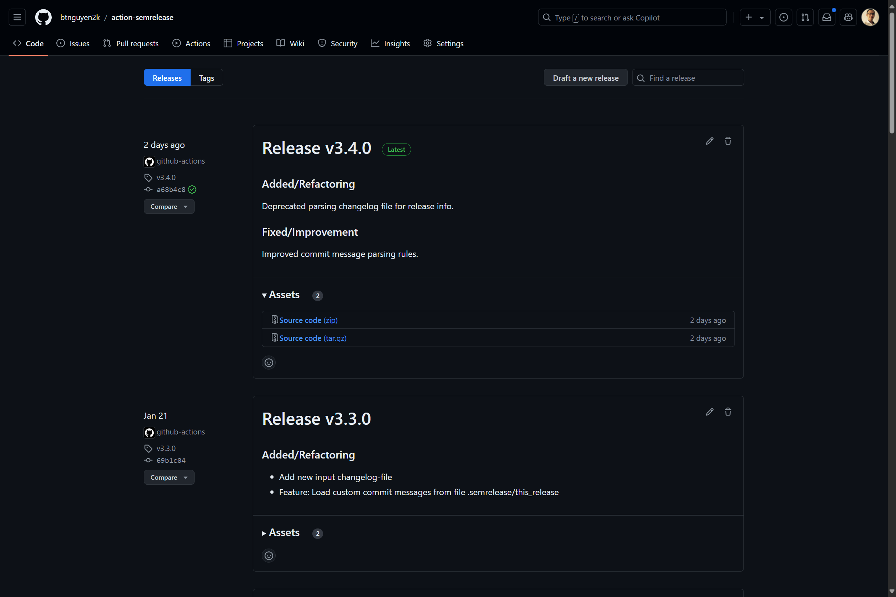

# SemRelease

[](RELEASE-NOTES.md)
[](https://github.com/btnguyen2k/action-semrelease/actions)
[](https://codecov.io/gh/btnguyen2k/action-semrelease)

GitHub Action to automatically create releases with tags, following [semantic versioning](https://semver.org/spec/v2.0.0.html) conventions.

## Usage

Use this Action as a step in your workflow file. For example:

```yaml
jobs:
  release:
    runs-on: ubuntu-latest
    permissions:
      contents: write
    outputs:
      RESULT: ${{ steps.release.outputs.result }}
      VERSION: ${{ steps.release.outputs.releaseVersion }}
      RELEASE_NOTES: ${{ steps.release.outputs.releaseNotes }}
    steps:
      - name: Checkout code
        uses: actions/checkout@v4
      - name: Install Node
        uses: actions/setup-node@v4
        with:
          node-version: 'lts/*'
      - name: Release
        id: release
        uses: btnguyen2k/action-semrelease@v5
        with:
          github-token: ${{ secrets.GITHUB_TOKEN }}

  post-release:
    runs-on: ubuntu-latest
    needs: [release]
    env:
      RESULT: ${{ needs.release.outputs.RESULT }}
      VERSION: ${{ needs.release.outputs.VERSION }}
      RELEASE_NOTES: ${{ needs.release.outputs.RELEASE_NOTES }}
    steps:
      - name: Print release result
        run: |
          printf 'Result: %s\nVersion: %s\nRelease notes:\n%s\n' "$RESULT" "$VERSION" "$RELEASE_NOTES"
```

Sample GitHub Actions workflows are available in the [samples](samples/) directory.

## How it works

This Action analyzes commit messages to determine if a new release is needed, and if so, automatically calculates the next version number and creates a new release tag with release notes compiled from commit messages. The following screenshot illustrates the result:



> The version number follows [semantic versioning](https://semver.org/spec/v2.0.0.html) conventions. The tag name can have an optional prefix, for example `v` (e.g. `v1.2.3`).

### Versioning rules

A new major version is released when a breaking change is detected in commit messages.
A new minor version is released when new or deprecated features or refactoring are detected.
A new patch version is released when only bug fixes, improvements/optimizations, security/dependency updates, or reverts are detected.

When calculating the version automatically, the highest qualifying bump wins: **MAJOR > MINOR > PATCH**.

Messages from GitHub history and `.semrelease/this_release` are normalized before release parsing: leading whitespace and `-`, `=`, or `+` markers are removed, and surrounding whitespace is trimmed. Markers inside the summary or body are preserved.

For headers starting with `type:` or `type(scope):`, the **type alone** determines the bump and release-note category. For example, `fix: breaking change` produces PATCH; words such as "removed" in its scope, summary, body, or footer cannot promote it to MAJOR. Use a breaking type such as `breaking:` or `breaking change:` for a major release. `refactor:` remains MINOR.

The following regular expressions recognize types and legacy unstructured headers:

```regexp
A breaking change is detected if any of the following rules match:

/^[^a-z]*(break(ing)?\s+)?change([ds])?(\([^)]+\)\s*)?:?\s+/i
/^[^a-z]*\[(break(ing)?\s+)?change([ds])?]:?\s+/i
/^[^a-z]*\((break(ing)?\s+)?change([ds])?\):?\s+/i
/^[^a-z]*break(ing)?(\([^)]+\)\s*)?:?\s+/i
/^[^a-z]*\[break(ing)?]:?\s+/i
/^[^a-z]*\(break(ing)?\):?\s+/i
/^[^a-z]*rem(ov(e|ing|es|ed))?(\([^)]+\)\s*)?:?\s+/i
/^[^a-z]*\[rem(ov(e|ing|es|ed))?]:?\s+/i
/^[^a-z]*\(rem(ov(e|ing|es|ed))?\):?\s+/i
/^[^a-z]*.+(is|are|been)( now)? removed.*/i
/^[^a-z]*.+no longer (available|support(s|ed)?).*/i
/^[^a-z]*ren(am(e|ing|es|ed))?(\([^)]+\)\s*)?:?\s+/i
/^[^a-z]*\[ren(am(e|ing|es|ed))?]:?\s+/i
/^[^a-z]*\(ren(am(e|ing|es|ed))?\):?\s+/i
/^[^a-z]*repl(ac(e|ing|es|ed))?(\([^)]+\)\s*)?:?\s+/i
/^[^a-z]*\[repl(ac(e|ing|es|ed))?]:?\s+/i
/^[^a-z]*\(repl(ac(e|ing|es|ed))?\):?\s+/i
/^[^a-z]*redesign(ing|ed|s)?(\([^)]+\)\s*)?:?\s+/i
/^[^a-z]*\[redesign(ing|ed|s)?]:?\s+/i
/^[^a-z]*\(redesign(ing|ed|s)?\):?\s+/i

A new/deprecated feature is detected if any of the following rules match:

/^[^a-z]*depr(ecat(e|ing|ed|es))?(\([^)]+\)\s*)?:?\s+/i
/^[^a-z]*\[depr(ecat(e|ing|ed|es))?]:?\s+/i
/^[^a-z]*\(depr(ecat(e|ing|ed|es))?\):?\s+/i
/^[^a-z]*.+(is|are|been)( now)? deprecated.*/i
/^[^a-z]*refactor(ing|ed|s)?(\([^)]+\)\s*)?:?\s+/i
/^[^a-z]*\[refactor(ing|ed|s)?]:?\s+/i
/^[^a-z]*\(refactor(ing|ed|s)?\):?\s+/i
/^[^a-z]*.+(is|are|been)( now)? refactor(ed|ing).*/i
/^[^a-z]*add(ing|ed|s)?(\([^)]+\)\s*)?:?\s+/i
/^[^a-z]*\[add(ing|ed|s)?]:?\s+/i
/^[^a-z]*\(add(ing|ed|s)?\):?\s+/i
/^[^a-z]*(new\s+)?feat(ure(s)?)?(\([^)]+\)\s*)?:?\s+/i
/^[^a-z]*\[(new\s+)?feat(ure(s)?)?]:?\s+/i
/^[^a-z]*\((new\s+)?feat(ure(s)?)?\):?\s+/i

A bug fix/improvement/optimization is detected if any of the following rules match:

/^[^a-z]*fix(ing|ed|es)?(\([^)]+\)\s*)?:?\s+/i
/^[^a-z]*\[fix(ing|ed|es)?]:?\s+/i
/^[^a-z]*\(fix(ing|ed|es)?\):?\s+/i
/^[^a-z]*.+(is|are|been)( now)? fix(ed|ing).*/i
/^[^a-z]*patch(ing|ed|es)?(\([^)]+\)\s*)?:?\s+/i
/^[^a-z]*\[patch(ing|ed|es)?]:?\s+/i
/^[^a-z]*\(patch(ing|ed|es)?\):?\s+/i
/^[^a-z]*.+(is|are|been)( now)? patch(ed|ing).*/i
/^[^a-z]*impr(ov(ing|es|ed|ement)?)?(\([^)]+\)\s*)?:?\s+/i
/^[^a-z]*\[impr(ov(ing|es|ed|ement)?)?]:?\s+/i
/^[^a-z]*\(impr(ov(ing|es|ed|ement)?)?\):?\s+/i
/^[^a-z]*.+(is|are|been)( now)? improv(ed|ing).*/i
/^[^a-z]*optimiz(e|ing|ation|es|ed)(\([^)]+\)\s*)?:?\s+/i
/^[^a-z]*\[optimiz(e|ing|ation|es|ed)]:?\s+/i
/^[^a-z]*\(optimiz(e|ing|ation|es|ed)\):?\s+/i
/^[^a-z]*.+(is|are|been)( now)? optimiz(ed|ing).*/i
/^[^a-z]*perf(ormance)?(\([^)]+\)\s*)?:?\s+/i
/^[^a-z]*\[perf(ormance)?]:?\s+/i
/^[^a-z]*\(perf(ormance)?\):?\s+/i
/^[^a-z]*sec(urity)?(\([^)]+\)\s*)?:?\s+/i
/^[^a-z]*\[sec(urity)?]:?\s+/i
/^[^a-z]*\(sec(urity)?\):?\s+/i
/^[^a-z]*dep(s|endenc(y|ies))?(\([^)]+\)\s*)?:?\s+/i
/^[^a-z]*\[dep(s|endenc(y|ies))?]:?\s+/i
/^[^a-z]*\(dep(s|endenc(y|ies))?\):?\s+/i
/^[^a-z]*revert(ing|ed|s)?(\([^)]+\)\s*)?:?\s+/i
/^[^a-z]*\[revert(ing|ed|s)?]:?\s+/i
/^[^a-z]*\(revert(ing|ed|s)?\):?\s+/i
/^[^a-z]*.+(is|are|been)( now)? revert(ed|ing).*/i
```

The following table illustrates how commit messages are mapped to release versions:

| Sample commit message                                                    | Release version   |
|--------------------------------------------------------------------------|-------------------|
| [BREAKING CHANGE] Hash function parameter is no longer optional          | New major release |
| Renamed hash function from MD5 to md5Hash                                | New major release |
| Replaces function `GetRelease()` with `GetLatestRelease()`               | New major release |
| API `GetBranches()` is removed and no longer available                   | New major release |
|                                                                          |                   |
| Method `MD5` is now deprecated and will be removed in future versions    | New minor release |
| The class Hashing is refactored to use SHA256                            | New minor release |
| Added new hash function `HashUtils::hashSha1()`                          | New minor release |
| [New feature] scan commit messages to build new release                  | New minor release |
|                                                                          |                   |
| Fixed typo in function `HashUtils::hashMd5()`                            | New patch release |
| Patched: function `HashUtils::Crc32()` now returns correct value         | New patch release |
| perf(API) function `HashUtils::hashChain()` is now 100% faster           | New patch release |
| Dependency(Dev) - bump `krypto` to v1.2.3                                | New patch release |
| [SECURITY]: fix potential SQLi security vulnerability in class `DbUtils` | New patch release |
| Docker image size has been optimized, reduced by half                    | New patch release |
| `deps: update the parser`                                                | New patch release |
| `revert: undo the previous change`                                       | New patch release |
| `fix: breaking change`                                                  | New patch release |
| `refactor: simplify parsing`                                            | New minor release |

### Commit message style

`style-check` validates **only the short summary on the first line**, after a recognized `type:` or `type(scope):` header. One optional space after the colon is treated as a separator. The summary must be non-empty, have no surrounding whitespace, not start with a capital letter, and not end with a period. All later lines are ignored, including body/footer content and blank-line formatting. These are mechanical checks, not an imperative-tense grammar check.

`style-check` defaults to `false`: violations log warnings and processing continues. Set it to `true` to fail the action before any tags or releases are created:

```yaml
with:
  style-check: true
```

Checks apply to the selected repository commit messages or `.semrelease/this_release` entries. Metadata comments and version directives are ignored. Leading markers (`-`, `=`, or `+`) are stripped from metadata entries before validation, without trimming summary whitespace. Types use the existing case-insensitive release rules and aliases, including multiword types such as `breaking change`; scope names have no whitelist. Unknown types (such as `docs` or `chore`) and malformed type/scope headers produce no style warnings or failures, even in strict mode. Legacy bracketed or sentence-style messages are also skipped by the style checker. None of these eligibility checks changes the existing version-bump or release-note rules.

### Inputs and Outputs

Inputs are supplied via the `with` block. For example:

```yaml
uses: btnguyen2k/action-semrelease@v5
with:
  github-token: ${{ secrets.GITHUB_TOKEN }}
  dry-run: true
```

The following inputs are accepted:

| Input                         | Required | Default         | Description                                                                   |
|-------------------------------|----------|-----------------|-------------------------------------------------------------------------------|
| github-token                  | Yes      |                 | GITHUB_TOKEN with `contents: write`, plus `actions: read` when attaching Actions artifacts; or a PAT with equivalent permissions. |
| dry-run                       | No       | `false`         | If `true`, the Action will run in dry-run mode.                               |
| style-check                   | No       | `false`         | Fail on invalid first-line summaries of recognized types when `true`; otherwise warn. |
| target-sha                    | No       | Event SHA       | Commit SHA to release and read metadata from; must be reachable from a configured branch. |
| tag-prefix                    | No       | `'v'`           | Prefix for release tags.                                                      |
| tag-major-release             | No       | `false`         | If `true`, create or move the major-version alias, e.g. `v1`.                 |
| tag-minor-release             | No       | `false`         | If `true`, create or move the minor-version alias, e.g. `v1.2`.               |
| branches                      | No       | `'main,master'` | Comma-separated list of branches to scan for commit messages.                 |
| path                          | No       | `''`            | Scan and Analyze only commits containing this file path.                      |
| tag-only                      | No       | `false`         | Create tags without publishing a GitHub release; artifact inputs are ignored. |
| artifact-ids                  | No       | `''`            | Current-repository Actions artifact IDs to attach unchanged as release assets; separate IDs with commas, semicolons or whitespace. |
| artifact-run-id               | No       | Current run ID  | Expected run ID for all selected artifacts; must originate from this repository at the target SHA. Other runs must have completed successfully. |

Full version tags (e.g. `v1.2.3`) are never moved; a conflicting target fails the action. Enabled major/minor aliases can move to the release target.

> ⚠️ **Removed inputs:** `auto-mode` and `changelog-file` are no longer supported.

This Action outputs the following:

| Output         | Description                                                                          |
|----------------|--------------------------------------------------------------------------------------|
| result         | The result of the Action's run. Possible values are `FAILED`, `SKIPPED`, `SUCCESS`.  |
| releaseVersion | The releasing version string, e.g. `1.2.3` (`tag-prefix` is not included!)           |
| releaseNotes   | The release notes.                                                                   |

## Customizing Version Numbers and Commit Messages

There may be scenarios where you want to customize the version number for a release. For instance, if the current version is `3.4.5` but you prefer the new release to be `6.0.0` instead of `3.4.6` or `3.5.0` or `4.0.0`. Additionally, since commit messages are used to compile the release notes, you might want to customize which commit messages are analyzed and included.

These customizations can be achieved by using the `.semrelease/this_release` file located in the repository's root directory. This file is a simple text file containing the following information:

```text
# Lines starting with '#' are comments and will be ignored.

Lines not starting with '#' are commit messages and will be used to analyze and compile the release notes.

- Each line should contain a single commit message only.

= Leading whitespace and `-`, `=`, or `+` markers are trimmed before parsing the commit message.
```

If the `.semrelease/this_release` file does not exist or contains no commit messages, the Action will fallback to analyzing commit messages from the repository's commits.

### Pre-release preparation and Post-release cleanup

Preparation and cleanup are optional, repository-owned steps. The action never edits `.semrelease/this_release`: you may keep, update or clear its content. Retained messages and version directives will still be evaluated on later runs.

This workflow fragment optionally appends release notes to `CHANGELOG.md` before publishing, then optionally clears `.semrelease/this_release`. The changelog is an output, not a source of release metadata. Preview mode skips commits, pushes and publication; change `DRY_RUN` to `'false'` to publish.

Run this for a commit on the release branch, with a token and branch policy that permit the shown pushes. Share the concurrency group with all publishers of this release stream. Preparation is committed and pushed before verification/publication use its SHA; add project-specific checks before publishing if preparation changes code or build outputs.

```yaml
env:
  RELEASE_BRANCH: 'release'
  TAG_PREFIX: 'v'
  DRY_RUN: 'true'
  PREPARE_CHANGELOG: 'true'
  CLEANUP_RELEASE_FILE: 'false'

defaults:
  run:
    shell: bash

concurrency:
  group: release-publication
  cancel-in-progress: false

jobs:
  release:
    runs-on: ubuntu-latest
    permissions:
      contents: write
    steps:
      - name: Checkout source
        uses: actions/checkout@v7
        with:
          ref: ${{ github.sha }}

      - name: Read release settings
        id: source
        run: |
          for flag in DRY_RUN PREPARE_CHANGELOG CLEANUP_RELEASE_FILE; do
            case "${!flag}" in
              true|false) ;;
              *) echo "::error::${flag} must be true or false"; exit 1 ;;
            esac
          done
          dry_run=$DRY_RUN
          if [[ -e .semrelease-dry-run ]]; then dry_run=true; fi
          printf 'sha=%s\ndry-run=%s\n' "$(git rev-parse HEAD)" "$dry_run" >> "$GITHUB_OUTPUT"
          if [[ "$dry_run" == true ]]; then
            echo "::notice::Preview only; preparation, publication and cleanup are skipped"
          fi
          git config user.name "github-actions[bot]"
          git config user.email "41898282+github-actions[bot]@users.noreply.github.com"

      - name: Plan release
        id: plan
        uses: btnguyen2k/action-semrelease@v5
        with:
          github-token: ${{ secrets.GITHUB_TOKEN }}
          target-sha: ${{ steps.source.outputs.sha }}
          branches: ${{ env.RELEASE_BRANCH }}
          tag-prefix: ${{ env.TAG_PREFIX }}
          dry-run: true

      - name: Prepare changelog
        if: >-
          steps.plan.outputs.result == 'SUCCESS' &&
          steps.source.outputs.dry-run == 'false' &&
          env.PREPARE_CHANGELOG == 'true'
        env:
          SOURCE_SHA: ${{ steps.source.outputs.sha }}
          VERSION: ${{ steps.plan.outputs.releaseVersion }}
          RELEASE_NOTES: ${{ steps.plan.outputs.releaseNotes }}
        run: |
          REMOTE_SHA=$(git ls-remote --exit-code origin "refs/heads/${RELEASE_BRANCH}" | cut -f1)
          if [[ "$REMOTE_SHA" != "$SOURCE_SHA" ]]; then
            echo "::error::Release branch changed; inspect the pinned source before retrying"
            exit 1
          fi
          if [[ -f CHANGELOG.md ]] && awk -v tag="${TAG_PREFIX}${VERSION}" \
            '{ sub(/\r$/, "") } $1 == "##" && $NF == tag { found = 1 } END { exit !found }' CHANGELOG.md; then
            echo "::error::Changelog already contains this version; inspect the previous preparation"
            exit 1
          fi
          if [[ ! -f CHANGELOG.md ]]; then printf '# Changelog\n' > CHANGELOG.md; fi
          printf '\n## %s - %s%s\n\n%s\n' "$(date +%F)" "$TAG_PREFIX" "$VERSION" "$RELEASE_NOTES" >> CHANGELOG.md
          git add -- CHANGELOG.md
          if ! git diff --cached --quiet -- CHANGELOG.md; then
            git commit -m "docs: prepare ${TAG_PREFIX}${VERSION} [skip ci]" -- CHANGELOG.md
            git push origin "HEAD:refs/heads/${RELEASE_BRANCH}"
          fi

      - name: Capture release target
        id: target
        if: steps.plan.outputs.result == 'SUCCESS' && steps.source.outputs.dry-run == 'false'
        run: |
          printf 'sha=%s\n' "$(git rev-parse HEAD)" >> "$GITHUB_OUTPUT"

      - name: Verify release target
        id: verify
        if: steps.plan.outputs.result == 'SUCCESS' && steps.source.outputs.dry-run == 'false'
        uses: btnguyen2k/action-semrelease@v5
        with:
          github-token: ${{ secrets.GITHUB_TOKEN }}
          target-sha: ${{ steps.target.outputs.sha }}
          branches: ${{ env.RELEASE_BRANCH }}
          tag-prefix: ${{ env.TAG_PREFIX }}
          dry-run: true

      - name: Check publication plan
        if: steps.plan.outputs.result == 'SUCCESS' && steps.source.outputs.dry-run == 'false'
        env:
          EXPECTED_VERSION: ${{ steps.plan.outputs.releaseVersion }}
          EXPECTED_NOTES: ${{ steps.plan.outputs.releaseNotes }}
          ACTUAL_RESULT: ${{ steps.verify.outputs.result }}
          ACTUAL_VERSION: ${{ steps.verify.outputs.releaseVersion }}
          ACTUAL_NOTES: ${{ steps.verify.outputs.releaseNotes }}
          RELEASE_SHA: ${{ steps.target.outputs.sha }}
        run: |
          if [[ "$ACTUAL_RESULT" != SUCCESS || "$ACTUAL_VERSION" != "$EXPECTED_VERSION" || "$ACTUAL_NOTES" != "$EXPECTED_NOTES" ]]; then
            echo "::error::Release target no longer matches the original plan; inspect before retrying"
            exit 1
          fi
          REMOTE_SHA=$(git ls-remote --exit-code origin "refs/heads/${RELEASE_BRANCH}" | cut -f1)
          if [[ "$REMOTE_SHA" != "$RELEASE_SHA" ]]; then
            echo "::error::Release branch changed after preparation; inspect before retrying"
            exit 1
          fi

      - name: Publish release
        id: publish
        if: steps.plan.outputs.result == 'SUCCESS' && steps.source.outputs.dry-run == 'false'
        uses: btnguyen2k/action-semrelease@v5
        with:
          github-token: ${{ secrets.GITHUB_TOKEN }}
          target-sha: ${{ steps.target.outputs.sha }}
          branches: ${{ env.RELEASE_BRANCH }}
          tag-prefix: ${{ env.TAG_PREFIX }}
          dry-run: false

      - name: Optional metadata cleanup
        if: >-
          steps.publish.outputs.result == 'SUCCESS' &&
          steps.source.outputs.dry-run == 'false' &&
          env.CLEANUP_RELEASE_FILE == 'true'
        env:
          VERSION: ${{ steps.publish.outputs.releaseVersion }}
          RELEASE_SHA: ${{ steps.target.outputs.sha }}
        run: |
          if [[ ! -f .semrelease/this_release ]]; then
            echo "::notice::No metadata file to clean"
            exit 0
          fi
          REMOTE_SHA=$(git ls-remote --exit-code origin "refs/heads/${RELEASE_BRANCH}" | cut -f1)
          if [[ "$REMOTE_SHA" != "$RELEASE_SHA" ]]; then
            echo "::error::Release published, but the branch changed; finish cleanup separately"
            exit 1
          fi
          printf '# Released %s%s.\n' "$TAG_PREFIX" "$VERSION" > .semrelease/this_release
          git add -- .semrelease/this_release
          if git diff --cached --quiet -- .semrelease/this_release; then
            echo "::notice::Metadata already clean"
            exit 0
          fi
          git commit -m "chore: clear release metadata after ${TAG_PREFIX}${VERSION} [skip ci]" -- .semrelease/this_release
          git push origin "HEAD:refs/heads/${RELEASE_BRANCH}"
```

Cleanup creates a later branch commit; the version tag stays on the published commit. A changed branch, existing changelog version or changed plan stops the workflow rather than overwriting state. Failed runs are not rolled back: inspect the branch, tags, release and assets before retrying. If publication succeeded but cleanup failed, finish the chosen cleanup separately instead of blindly publishing again.

## License

This project is licensed under the MIT License. See the [LICENSE.md](LICENSE.md) file for details.

## Support and Contribution

Feel free to create [pull requests](https://github.com/btnguyen2k/action-semrelease/pulls) or [issues](https://github.com/btnguyen2k/action-semrelease/issues) to report bugs or suggest new features.
Please search the existing issues before filing new ones to avoid duplicates. For new issues, file your bug or feature request as a new issue.

If you find this project useful, please start it.
